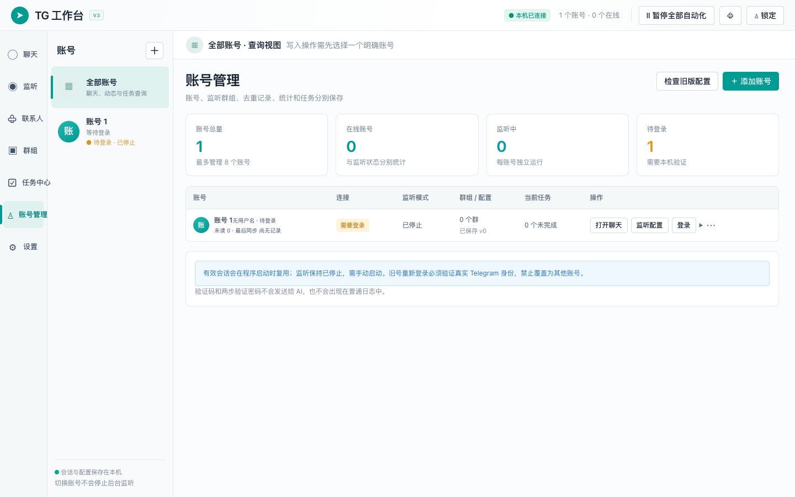

# TG 多账号工作台

根据 2026-10-22 的完整需求与界面设计 V0.2 开发。本机浏览器面板，Python / Telethon 后台，最多管理 8 个本人拥有的 Telegram 账号。支持由用户主动选择旧版本地配置进行迁移。

## 从源码安装

开发验证环境为 macOS、Python 3.14、Telethon 1.45；界面无需 Node 构建，Node 仅用于界面测试。后台使用 `fcntl`，Windows 未作适配。

下载仓库后，在工程目录执行：

```sh
python3 -m venv .venv
.venv/bin/python -m pip install -r requirements.txt
export TG_WORKBENCH_STATE_DIR="$HOME/.local/share/telegram-workbench"
.venv/bin/python -B server.py
```

首次启动会打开本机浏览器面板，然后在“设置”填写自己的 Telegram 应用 API ID 和 API Hash，再添加账号。每次启动使用相同的 `TG_WORKBENCH_STATE_DIR` 以复用本机数据。源码不包含预配置凭据、登录账号或运行数据库。

仓库内的 `.app` 和 `启动.command` 依赖原开发目录布局中的独立运行环境；在其他机器上请使用上述源码启动方式。Mac 应用入口源码见 `packaging/launcher.applescript`，可用 `osacompile -o "TG 多账号工作台.app" packaging/launcher.applescript` 重新构建。



## 打开与首次登录

双击 **TG 多账号工作台.app**，或双击 **启动.command**。浏览器只连接这台 Mac 的 `127.0.0.1`，无需网站托管。

1. 在“设置”确认 Telegram 应用凭据已配置。需要填写时，使用自己的 API ID 与 API Hash；秘密保存后不会回显。
2. 打开“账号管理 → 添加账号”，在本机输入完整国际手机号、收到的验证码及两步验证密码（如有）。验证码渠道由 Telegram 决定。
3. 成功后设置内部名称，例如“测试 A”。再次添加另一个账号，命名“测试 B”。两个账号的登录会话分别保存。
4. 从固定账号栏切换账号。查看聊天、群组、联系人、监听配置和任务时，先核对顶部身份。

**验证码、密码、API Hash 和会话文件不要发到聊天中。** 新登录账号默认停止监听。有效会话可在下次启动复用；应用退出或重启不会自动开始实际添加、发送排队消息或继续清空。

## 功能与使用边界

| 页面 | 可用操作 |
| --- | --- |
| 聊天 | 分账号或聚合会话、本地名称/消息搜索、未读/私聊/群聊筛选、按需历史、实时文字、图片和文件、回复、权限允许的编辑和撤回、独立草稿、未知结果检查 |
| 监听 | 各账号独立多群选择与搜索、预览/实际添加、配置版本和运行批次、运行中保存到后续新消息、停止/暂停、分项统计与动态、持久去重 |
| 联系人列表 | 全部当前联系人刷新、姓名/用户名/标签/来源筛选、备注和邀请授权记录、手动添加、CSV 导入预览、删除选中联系人 |
| 批量邀请 | 明确账号、名单与目标群，同意确认和只读预览；逐人五类结果、单人失败继续、整批暂停、恢复前检查、未知重新核实、CSV 导出 |
| 联系人清理 | 停止本账号添加、排空在途、独占写入、范围检查、本机备份与摘要、账号名称及两项风险确认、最终快照复核、逐项删除和最终验证 |
| 群组 | 当前账号可访问的群、信息和权限，进入聊天或选择为监听范围 |
| 任务 | 添加/删除联系人、邀请、显式发送邀请链接或消息的预览与确认；独立账号队列、暂停/取消、确定失败重试、持久执行记录和导出 |
| AI | 默认关闭；配置兼容服务后，仅对明确选择的当前会话生成回复草稿，或将自然语言转为受限任务草稿；不会自动发送或执行 |
| 设置 | 应用凭据、快捷键、通知、AI 服务与上下文范围、日志保留、面板锁定、缓存清理、私密应用备份和后台退出 |

自动添加只处理启动/恢复边界之后的实时新消息；不读取历史发言补加，不抓群成员列表，不发送问候私信。跳过自己、机器人、匿名/频道身份、现有联系人和已成功处理者。预览不写成功去重。删除联系人或清空不会清除成功去重；高级重置需单独确认。

添加联系人是单向保存，不是双方互加，也不构成同意邀请。程序不增加手机号可见例外；仍需在 Telegram 中核对自己的手机号隐私设置。

## 双账号测试建议

先使用本人账号与双方同意参加的测试会话，不用客户名单做初次验证。

1. 登录 A、B，确认真实身份、脱敏号码与状态不同。反复切换七个页面，检查群组和任务归属。
2. 在 A 的会话输入一段不发送的草稿，再到 B 的会话输入另一段；返回确认各自保留。聚合会话的发送身份锁定为该会话所属账号。
3. 选择本人可控的聊天，分别发送少量测试文字、图片或文件，检查实际收取和发送状态。结果未核实先检查，不重复点击重发。
4. A、B 分别选择自己的测试群，先保存“仅预览”；让另一测试用户发一条新消息，检查账号、群、运行版本与“未修改联系人”。之后才按需测试实际添加。
5. 停止两号监听后退出后台，重新打开，确认会话可恢复、监听仍停止。A 断开时 B 的页面和草稿不应改变。

界面与自动测试不能代替真实 Telegram 验收。邀请后的成员核实、媒体权限、实际账号限制及保存号码导出能力由平台决定；首次使用请小范围验证。

## 任务暂停、等待与未知结果

- 每个账号有独立写入队列；人工聊天优先于普通自动任务。清空的联系人锁不阻止人工聊天或其他账号。
- 单个邀请对象隐私受限、失败或未核实，记录后继续；账号/群权限/网络/限流错误暂停整批，不自动换号或改发链接。
- 平台给出等待秒数时显示恢复时间，不允许提前解除。没有时长的限制需人工检查后明确确认；解除本地暂停不代表 Telegram 已解除限制，也不会自动恢复任务。
- 请求提交前记录在途状态。程序重启或响应不明后，未知项先读取核实，不自动重复提交；没有足够证据时保持未核实。
- 停止/取消阻止后续请求，已提交请求仍可能完成。若停止超时，保留在途保护，不能越过它开始清空。
- 清空暂停或中断后必须重新核对、备份和完整确认，不通过普通“重试”继续删除。

不存在可承诺的安全固定每日添加或邀请额度。

## 全部清空的能力说明

清空只作用于所选账号，不删除聊天、不拉黑、不移出群。备份仅含可导出的已注册联系人，不含未注册号码；没有一键恢复。

Telegram 的 `saved_count` 不能直接用作未注册号码数。完整保存号码读取需要平台允许的 takeout 导出；保存号码本身没有注册状态字段。如果导出被要求等待，或号码注册状态/完整删除范围无法可靠核实，界面会明确显示 **不支持完整清空**，并禁止最终删除。已注册联系人仍可通过“删除选中”逐项预览处理，不能称为完整清空。

若最终确认前联系人发生变化、备份不可读或摘要不符，确认作废。取消、失败或清空完成后，监听保持停止。其他 Telegram 客户端同步联系人可能再次导入数据；本程序不修改其他客户端的同步设置。

## 旧版迁移

账号管理中的“检查旧版配置”只在你主动选择来源后读取、私有备份并复制旧文件，连接复制的会话核实身份，再展示预览。确认后新增独立账号，不原地升级旧文件，不覆盖已有账号。

旧配置可迁移应用凭据与群 ID；旧版没有持久的运行统计和成功去重，因此不能迁移这些记录。导入后使用预览配置并保持停止。旧程序仍占用会话时，先在旧程序停止并退出，再检查导入。也可直接在新工作台重新登录，不导入旧会话。

## 本机数据与运行

原开发目录布局下，默认私有运行目录为工程所在目录上两级中的 `work/telegram-workbench-runtime`。从 GitHub 下载后请按“从源码安装”显式设置自己的 `TG_WORKBENCH_STATE_DIR`。

应用数据为 `workbench.sqlite3`，独立会话位于 `accounts/<内部账号ID>/account.session`。文件权限为 600，私有目录为 700。应用备份可能包含账号会话和服务密钥，不要分享或提交代码仓库。

关闭网页仅关闭视图，后台仍运行。使用顶部“暂停全部自动化”停止新自动化写入；使用“设置 → 退出后台程序”查看受影响工作并安全退出。Mac 需要保持唤醒与联网。没有安装开机自启，不承诺关机或休眠时运行。

独立环境启动命令：

```sh
.venv/bin/python -B server.py
```

在本目录执行。高级部署可在启动前设置 `TG_WORKBENCH_STATE_DIR` 选择另一私有存储目录；不在运行中移动会话文件。

## 验证

在本目录运行：

```sh
.venv/bin/python -B -m unittest discover -s tests -v
node --test tests/*.test.cjs
```

自动测试使用临时目录和模拟 Telegram/AI，不对真实账号添加、删除、发送或邀请。浏览器验收将真实空面板与模拟双账号交互区分记录。完整验收证据在 `docs/verification.md` 更新。

源需求保存在 `docs/source/requirements.md` 与 `docs/source/design.md`；计划与模块接口位于 `docs/superpowers/plans` 和 `docs/api-contract.md`。

第一版不包含 AI 自动回复、定时任务、二维码登录、语音视频通话、秘密聊天或手机完整适配。

## 公开发布内容

此仓库是完整工程的脱敏发布快照，包含后台、界面、测试、需求设计、验收记录与 Mac 启动入口。本机开发历史留在原工程；发布快照使用独立历史，避免携带旧提交中的机器目录和真实测试账号信息。Telegram 会话、应用密钥、客户数据、缓存、备份与运行数据库均不包含在仓库内。
